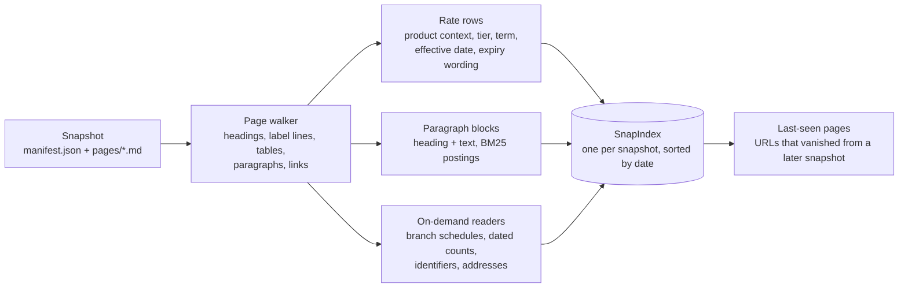
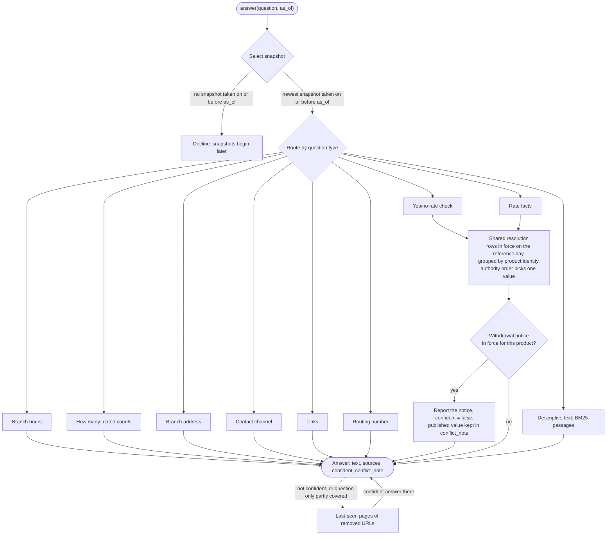
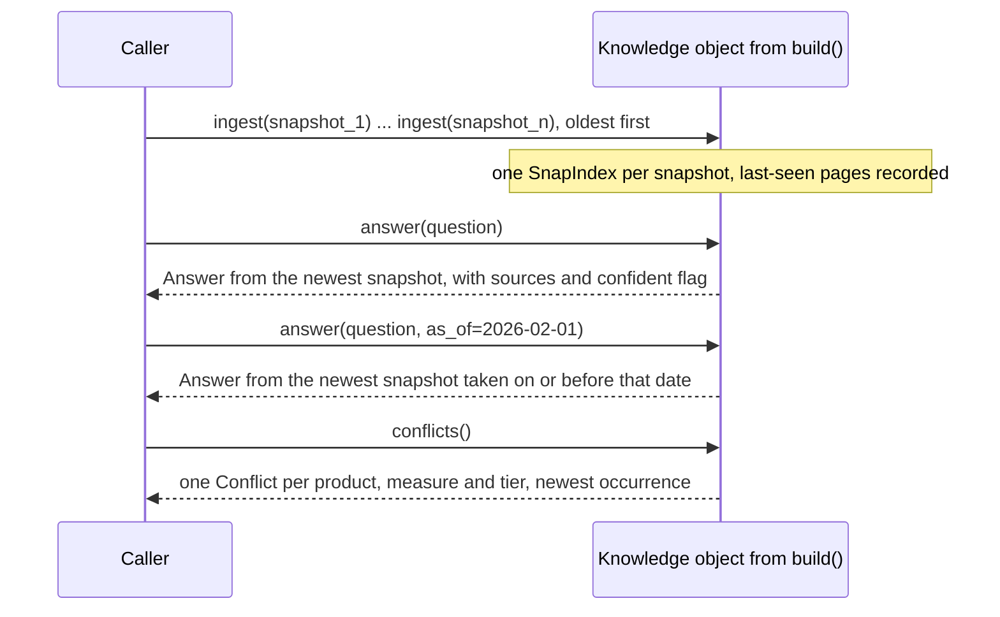
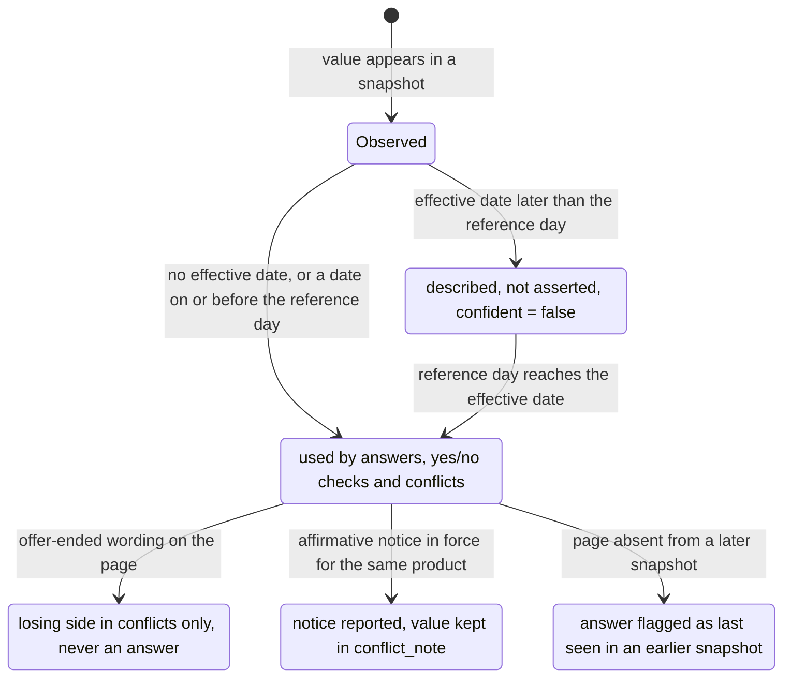

# Snapshot Knowledge

[](LICENSE)


A small, dependency-free knowledge system that answers questions about an organisation's
website from a series of dated **snapshots** of that site. It answers as the site stood on a
given date, cites the page versions that support each statement, declines when the snapshots
do not support an answer, and reports the places where pages contradict each other.

The core idea is to separate **observation time** (when a page was crawled) from **valid
time** (when a published value is actually in force), and to treat every answer as a claim
that must be traceable to a quoted page version. Nothing is generated: every number in an
answer comes from a page, and every page is named.

> [!IMPORTANT]
> The real website pages this system was developed against belong to an organisation and
> cannot be redistributed, so they are **not** part of this repository. The code is written
> against the snapshot format described below rather than against any particular organisation.
> It was developed and tested on English-language financial-institution pages (rates, fees,
> branches, membership) and has not been tried on other kinds of sites. `tests/fixtures/`
> contains a complete fictional example that every test and demo in this document runs against.

## Contents

- [System architecture and data flow](#system-architecture-and-data-flow)
- [Key features and technical highlights](#key-features-and-technical-highlights)
- [Repository structure](#repository-structure)
- [Getting started](#getting-started)
- [Usage and verification](#usage-and-verification)
- [How answers are produced](#how-answers-are-produced)
- [Sources and quotes](#sources-and-quotes)
- [Known limitations](#known-limitations)
- [License](#license)

## System architecture and data flow

Everything lives in one module, `solution.py`, organised as three stages: **ingest** builds one
index per snapshot, **answer** routes a question to the extractor that owns that kind of fact
and applies the temporal rules, and **conflicts** reports disagreements inside each snapshot.
The standard library is the only dependency; retrieval is BM25 over paragraph blocks.

### Ingestion: one index per snapshot



Snapshots are ingested oldest first. Each page is walked line by line: Markdown headings and
short bare *label lines* above a table give rate rows their product identity; tables and
single-line rate statements become structured rows; everything else becomes paragraph blocks
indexed for retrieval. Pages present in an earlier snapshot but absent from a later one are
kept in a separate *last-seen* index for that later snapshot.

### Answering: route, resolve, guard



Every path computes facts against one **reference day**: `as_of` when given, otherwise the
date of the selected snapshot. A statement marked *effective &lt;date&gt;* with a date after the
reference day is *scheduled*: it is described, never asserted. Rate answers, yes/no rate
checks and `conflicts()` share one resolution step so that they cannot disagree with each
other; the other extractors apply the same valid-time rule with logic of their own.

### Contract with a caller



### Life cycle of a published value



## Key features and technical highlights

| Capability | What the system does | Mechanism |
|---|---|---|
| Observation vs. valid time | "Current" means the newest ingested snapshot, never the machine clock. A value published in January to take effect in March is not the January answer. | Reference day per question; *effective &lt;date&gt;* parsed in three formats from the line below or above a table, a rate sentence, a schedule, a contact line or a paragraph. |
| Historical questions | `as_of` reads the newest snapshot taken on or before that date; earlier than the first snapshot is declined; later than the last is answered with a note. | One `SnapIndex` per snapshot, selected by date. |
| Removed vs. withdrawn | A page that disappears is ambiguous and may still answer, flagged as last seen. A withdrawal is an explicit, affirmative, in-force notice about the same product, and it also binds values still published. | Last-seen index per snapshot; notice predicates with voice, negation, tense and product-identity checks. |
| Product identity | Term, balance tier, model year, personal vs. business, regular vs. jumbo, standard vs. introductory and IRA variants are matched separately. A product the site does not have is declined, not approximated. | Identity from headings and label lines; name-word sets compared exactly between tables. |
| One truth for rate facts | Rate answers, yes/no rate checks and `conflicts()` reuse the same rows, grouping and authority order. | Rate sheet over product pages over promotions and articles; tables over sentences; newer effective and fetch dates win ties. |
| Conflict reporting | Pages inside one snapshot that publish different values for the same product, measure and tier are listed once, from the newest occurrence, with the preferred value and the reason. Expired offers appear as the losing side so the disagreement is explained rather than hidden. | Identity-aware deduplication across snapshots; future-dated tables are scheduled changes, not conflicts. |
| Descriptive questions | Eligibility, programmes, fees, closures and recognitions are answered with the best paragraph and its heading; fee and minimum questions need an amount or an explicit "no fee"; a named product must be the paragraph's subject. | BM25 with light stemming, page-type and heading weighting, product-family and business penalties, evidence filters. |
| Contact and branch facts | Phone numbers come only from the contact page's own general line or from a branch's own section; fax, partner, PIN and fraud lines are never offered as the main number. Hours are bound to branch and service. | Section-aware line reading with role vocabularies; schedules keyed by branch and service with effective dates. |
| Traceability | Every `Source` names the page URL, the snapshot in which that page version was observed and a verbatim cleaned quote. Tests check every quote against the cited page version. | Quotes trimmed from the page text after Markdown markup is stripped. |
| Determinism and speed | Identical output across Python hash seeds; about 0.2 s per answer and a few seconds to ingest thousands of page versions. | Fixed iteration orders, no randomness, no I/O at answer time. |
| Release hygiene | A release check keeps names and data from the confidential development corpus out of the public tree: it scans files, the index or the whole history, fails closed without its policy, and is wired into Git hooks. | `tools/privacy_check.py`, `tools/release_allowlist.txt`, `.githooks/`. |

## Repository structure

```text
snapshot-knowledge/
├── solution.py                  # the whole system: parsing, indexing, routing, resolution, conflicts
├── README.md                    # this document
├── NOTES.md                     # design rationale, temporal model, assumptions and limits
├── LICENSE                      # MIT
├── requirements.txt             # intentionally empty: standard library only
├── .gitignore
├── tests/
│   ├── test_solution.py         # 42 behaviour tests on the fixture snapshots
│   ├── test_edge_cases.py       # 67 counterexample tests: valid time, withdrawal, identity, scope, contact, fees
│   ├── test_privacy_check.py    # 10 tests for the release check
│   └── fixtures/snapshots/      # a fictional credit union, two dated snapshots (12 and 13 pages)
│       ├── 01_2026-01-10_baseline/{manifest.json, pages/p00.md ...}
│       └── 02_2026-03-15_recrawl/{manifest.json, pages/p00.md ...}
├── tools/
│   ├── privacy_check.py         # release check: --staged, --files, --history; fails closed without a policy file
│   ├── release_allowlist.txt    # the only paths that may be published
│   └── install_hooks.sh         # enables .githooks for this clone only
└── .githooks/
    ├── pre-commit               # release check on the index, then the test suite
    └── pre-push                 # refuses unless release.pushAuthorized=yes and the full history passes
```

## Getting started

### Prerequisites

| Requirement | Value | Notes |
|---|---|---|
| Python | 3.11 | Standard library only; `requirements.txt` lists nothing to install. |
| Operating system | macOS or Linux | Developed on macOS; nothing platform-specific is used. |
| Network access | None | No API keys, no external services, no downloads at run time. |
| Disk | A few MB | The fixture snapshots are small Markdown files. |

### Installation

```bash
git clone https://github.com/aiyufan3/snapshot-knowledge.git
cd snapshot-knowledge
python3.11 -m venv .venv && . .venv/bin/activate
python -m unittest discover -s tests -q      # 119 tests on fictional data, about two seconds
```

> [!NOTE]
> There is nothing to install beyond Python itself. The virtual environment is only there to
> make the interpreter version explicit and to keep the run reproducible.

### Input format

A snapshot is a folder with a `manifest.json` and the pages as Markdown files:

```text
snapshots/
  01_2026-01-10_baseline/
    manifest.json
    pages/p00.md ...
  02_2026-03-15_recrawl/
    ...
```

```json
{"snapshot_id": "01_2026-01-10_baseline", "taken_on": "2026-01-10",
 "pages": [{"file": "pages/p00.md", "url": "https://www.example-cu.example/rates",
            "title": "Rates", "fetched_at": "2026-01-10T08:00:00Z"}]}
```

The objects passed to `ingest()` carry the same fields:

| Object | Field | Type | Meaning |
|---|---|---|---|
| snapshot | `snapshot_id` | `str` | Identifier echoed in every `Source` and `Conflict`. |
| snapshot | `taken_on` | `str`, `YYYY-MM-DD` | Observation date; defines snapshot order and the default reference day. |
| snapshot | `pages` | `list` | Page objects below. |
| page | `url` | `str` | Page URL; the site's own domain is learned from these, nothing is hard-coded. |
| page | `title` | `str` | Page title; the part before a `\|` is used as the top-level heading. |
| page | `markdown` | `str` | Page content as Markdown. |
| page | `fetched_at` | `str`, ISO timestamp | Fetch time; breaks ties between otherwise equal rows. |

### Interface

`solution.py` exposes `build()`, which returns an object with three methods:

| Method | Behaviour |
|---|---|
| `ingest(snapshot)` | Called once per snapshot, oldest first. Parses rate tables and single-line rate statements into rows that keep their product context, tier, term, model-year range and effective date; indexes paragraphs for text retrieval; records links. |
| `answer(question, as_of=None)` | Answers from the newest snapshot, or from the newest snapshot taken on or before `as_of`. Returns `text`, `sources` (url, snapshot id, quote), `confident` and an optional `conflict_note`. |
| `conflicts()` | Lists places where pages inside the same snapshot publish different values for the same product, tier and measure, with the value the system treats as current and why. One entry per product, measure and tier; a disagreement seen again in a later snapshot is reported once, from that snapshot. |

The method signatures and the `Answer` / `Source` / `Conflict` shapes follow a small `contract`
module when one is importable (a host application can put its own on `sys.path`); otherwise
equivalent stand-in dataclasses are used, so the module also runs on its own.

| Return type | Fields |
|---|---|
| `Answer` | `text: str`, `sources: list[Source]`, `confident: bool`, `conflict_note: str or None` |
| `Source` | `url: str`, `snapshot_id: str or None`, `quote: str or None` |
| `Conflict` | `topic: str`, `values: list`, `sources: list[Source]`, `resolution: str or None`, `reason: str or None` |

### Configuration

The system itself has no configuration: no files, no environment variables, no flags. The
only settings belong to the release tooling and apply to a clone, never globally:

| Setting | Where | Purpose |
|---|---|---|
| `core.hooksPath=.githooks` | `git config` (local), set by `tools/install_hooks.sh` | Enables the pre-commit and pre-push hooks for this clone. |
| `release.policyfile=<path>` | `git config` (local), or `RELEASE_POLICY_FILE`, or `--policy` | Points the release check at a policy file kept **outside** the repository. Without it the check fails closed. |
| `release.pushAuthorized=yes` | `git config` (local) | Deliberate, manual switch without which `pre-push` refuses every push. Nothing in the repository sets it. |

## Usage and verification

### Python API

```python
import solution
ks = solution.build()
for snap in snapshots:            # objects with snapshot_id, taken_on, pages[url,title,markdown,fetched_at]
    ks.ingest(snap)
a = ks.answer("What is the 6-month certificate APY?")
a = ks.answer("What is the 6-month certificate APY?", as_of="2026-02-01")
for c in ks.conflicts():
    print(c.topic, c.values, c.resolution)
```

### Quick demo on the fictional fixtures

The following runs from the repository root with no dependencies and prints a few answers
and the conflict list for the fixture snapshots:

```bash
python3 - <<'EOF'
import json, sys
from pathlib import Path
from types import SimpleNamespace as N
sys.path.insert(0, ".")
import solution
ks = solution.build()
for folder in sorted(Path("tests/fixtures/snapshots").iterdir()):
    manifest = json.loads((folder / "manifest.json").read_text())
    pages = [N(url=p["url"], title=p.get("title", ""), markdown=(folder / p["file"]).read_text(),
               fetched_at=p.get("fetched_at", manifest["taken_on"])) for p in manifest["pages"]]
    ks.ingest(N(snapshot_id=manifest["snapshot_id"], taken_on=manifest["taken_on"], pages=pages))
for q, day in [("What is the 6-month certificate APY?", None), ("What is the 6-month certificate APY?", "2026-02-01"),
               ("What are the lobby hours for the Harbor branch?", None), ("How do I contact you?", None),
               ("Who is eligible to become a member?", None)]:
    a = ks.answer(q, as_of=day)
    print(f"{q} [{day or 'latest'}] -> confident={a.confident}\n  {a.text}\n  sources: {[s.url for s in a.sources]}")
for c in ks.conflicts():
    print(f"conflict: {c.topic}: {c.values} -> {c.resolution}")
EOF
```

What the fixture data yields:

| Question | `as_of` | Result |
|---|---|---|
| What is the 6-month certificate APY? | latest | `Regular Certificates, 6 Month: 4.10% APY.` with the rate-sheet page as source. |
| What is the 6-month certificate APY? | `2026-02-01` | `… 4.00% APY.` from the earlier snapshot only. |
| What is the 6-month certificate APY? | `2025-06-01` | Declined: the snapshots do not cover that date. |
| What is your rate on a 7/1 adjustable-rate mortgage? | latest | Declined (`confident=False`); nothing on the site lists it. |
| What are the lobby hours for the Harbor branch? | latest | The lobby schedule published for that branch, not the drive-up schedule and not another branch's. |
| How do I contact you? | latest | The phone number the contact page presents as the organisation's line, plus that page's URL. |
| `conflicts()` | | Three entries, the first being `Regular Certificates, 6-month APY: ['4.10% APY', '4.25% APY'] -> 4.10% APY`, citing the rate sheet and the promotional page whose offer has ended. |

### Tests and release checks

```bash
python -m unittest discover -s tests -q          # behaviour tests on fictional data
python tools/privacy_check.py --files README.md  # release check (needs a private policy file)
sh tools/install_hooks.sh                        # enable the repository's Git hooks
```

| Suite | Tests | Covers |
|---|---|---|
| `tests/test_solution.py` | 42 | Temporal selection, no fabrication, product context, extractors, conflicts, interface shapes. |
| `tests/test_edge_cases.py` | 67 | Counterexamples: effective-date scope on every path, withdrawal semantics, conflict identity, eligibility-area completion, phone roles and branch attribution, named-product fee evidence. |
| `tests/test_privacy_check.py` | 10 | Generic rules, policy handling, allowlist, fail-closed behaviour of the release check. |

`tools/privacy_check.py` scans the Git index (`--staged`), working-tree files (`--files`) or
the whole history (`--history`) for material that must not be published: terms from the
confidential development corpus, listed in a policy file kept **outside** the repository,
plus built-in rules for keys and tokens, private-key blocks, home-directory paths, e-mail addresses and attribution trailers.
File paths are checked as well as contents, and every published path must match
`tools/release_allowlist.txt`. In history mode the commit message is checked like file
content; author and committer fields are checked against the policy terms only. Without a
policy file the check fails closed; the functional tests do not need it. The `pre-commit`
hook runs the staged check and the tests; the `pre-push` hook refuses to push unless the
clone was explicitly authorised (`git config release.pushAuthorized yes`) and the full history
passes.

> [!WARNING]
> The hooks guard against mistakes; they are not a substitute for review. Findings print a
> rule id and a location only, so that neither policy terms nor matched text are echoed.

### Beyond the fixtures

The fixtures are the reproducible part of this repository. The system was also developed and
checked against a much larger corpus of real financial-institution pages, crawled on several
dates, which cannot be redistributed; the rules in the next section and the counterexample
tests came out of that work. Nothing in this repository depends on that corpus.

## How answers are produced

| Rule | Behaviour |
|---|---|
| Observation time vs. valid time | "Current" means the newest ingested snapshot, never the clock of the machine. With `as_of`, only the newest snapshot taken on or before that date is used; a date before the first snapshot is declined; a date after the last snapshot is answered from the last snapshot with a sentence saying so. Inside a snapshot, a statement marked *effective &lt;date&gt;* (MM/DD/YYYY, "Month D, YYYY" or YYYY-MM-DD; the line just below a table or just above it, a rate sentence, the line above a branch schedule, a contact-page line, a paragraph) is in force only from that date. An in-force value wins and the scheduled one is mentioned in `conflict_note`; if only a future-dated value exists, the answer describes it as not yet in effect (`confident=False`). The date binds only the statement it sits next to, never a neighbouring table or section. |
| Removed and withdrawn pages | A page that disappears from later snapshots can still answer a question, flagged as last seen in an earlier snapshot: a missing page is ambiguous, not a withdrawal. A withdrawal is a notice in the selected snapshot that is affirmative ("has not been discontinued" is not one), in force on the reference day ("will be discontinued effective &lt;date&gt;" applies from that date) and about the product asked for (its subject or object carries the question's product words, or the family word for a family-wide notice, and names no other product or variant). Such a notice binds values from removed pages and values still published alike: the answer reports the notice with `confident=False` and keeps the published value in `conflict_note` only. Values that *change* on a page that still exists are never taken from the older version. |
| Qualifiers and identity | Term, balance tier, model year, personal vs. business, regular vs. jumbo, standard vs. introductory and IRA products are matched separately. Product identity comes from the table's own context (headings and the short label lines preceding it). A question that names a product the site does not have is declined rather than answered with a similar product. |
| Sentences vs. tables | A percentage in a sentence becomes a rate fact only when the sentence states exactly one percentage, names the measure (rate, APR, APY, dividend rate) and sits under a heading that names the product. Percentages that describe a loan type ("fixed-rate"), an increment or cap, a share, a down payment, or a rate that is not a price are not rates. A sentence is weaker evidence than a table about the same product. |
| One resolution for rate facts | Ordinary rate answers, yes/no questions about a rate and `conflicts()` share the same rows, grouping and authority order: rate sheet over product pages over promotional, landing and article pages; tables over sentences; newer effective dates and fetch dates win ties. Answers and yes/no checks use only rows in force and not expired; `conflicts()` also lists an expired offer or a product page that still disagrees with the rate sheet, as the losing side, so that the disagreement is explained rather than hidden. Branch hours, contact numbers and paragraphs are not rate rows: they apply the valid-time rule with rules of their own, not the rate-sheet authority order. |
| Declining and confidence | `confident=False` means the system cannot give the value asked for. Plain declines carry no sources and no numbers beyond those in the question. Some low-confidence answers do carry sources and extra text: a scheduled future value, a discontinuation notice, or the site's contact details for a procedural question the pages do not answer. Nothing is invented: with no pages ingested every question is declined. |
| Descriptive questions | Eligibility, programmes, closures, recognitions and fees are answered with the best-matching paragraph and its heading, preferring the organisation's own product pages over articles and, among dated articles, the most recent one. A question that names a product ("Free Checking") prefers paragraphs about that product; paragraphs about another product of the same family, or about business products when the question is not about business, are weaker matches. A paragraph that ends by introducing a list is completed with the next paragraph under the same heading when that paragraph is a list or carries no amounts; a new section is never appended. |
| Fees and minimums | A fee or minimum question is answered only by a paragraph that states an amount or says there is none ("no monthly fee"); mentioning a fee, or the word "free" on its own, is not enough. When such a question names a product, the paragraph must be about that product (named in its heading, its label line or its text, and not a business variant); otherwise the question is declined rather than answered from a sibling product. |
| Eligibility areas | An eligibility question whose best match states no criteria is answered with `confident=False`. When the criteria refer to an area by name ("within our charter area") the answer is completed, in this order, with a sentence that defines the area on the same page or the membership pages; with a definition of the charter area or field of membership elsewhere on the site (a full list of places, or a list introduced with a colon); or, marked as separate context, with the places served stated on the membership pages. Each is cited as a further source. Office locations are never presented as the eligibility area, and places served by another line of business (an insurance agency, a partner) are never used. |
| Branch hours | Hours are bound to the branch and service (lobby / drive-up) they were published for; a branch without published hours is declined rather than given another branch's hours. |
| Reaching the organisation | "How do I contact you?" and "what is your phone number?" are answered with the number the site's own contact page presents as its line (phone, call us, member service) together with that page's address. A fax, partner, rewards, PIN or fraud line is never used for it, and a number appearing often on the page is not evidence; without a general number the answer points to the contact page and states no number. A branch's phone number is given only when it is listed in that branch's own section; otherwise the question is declined without any number. A question about a specific line (a lost card, a PIN) is answered from the page text like any other descriptive question. |

See `NOTES.md` for the reasoning behind these rules and their known limits.

## Sources and quotes

Each `Source` names the page URL, the snapshot in which that version of the page was observed
and a `quote`. Quotes are excerpts of the page text after Markdown links, emphasis and
footnote markers have been stripped and whitespace collapsed (a table row is quoted as the row
itself). The tests check every quote against the cleaned text of the cited page version.

> [!NOTE]
> A quote shows what was matched; whether it answers the question is for the reader to judge,
> and the low-confidence cases above are where the system itself is unsure. Two parsing
> boundaries matter when reading a quote. A table row's product is read from the headings and
> the short label lines above the table, so the quoted row may not repeat the product name;
> the answer text does. Dates are read only from the wording *effective &lt;date&gt;* next to the
> statement; other dates on a page (events, publication dates) do not change when a value
> applies.

## Known limitations

| Area | Limitation |
|---|---|
| Retrieval | Lexical (BM25 over paragraphs with light stemming and a handful of generic synonyms). A question phrased very differently from the page can pick a related but wrong paragraph; when that happens the cited quote shows exactly what was matched. |
| Relative dates | "Last year" and similar are resolved against the snapshot date, not the wall clock. If no figure exists for the requested year the answer says so and reports the most recent published figures instead. |
| Valid-time wording | Read only from *effective &lt;date&gt;*. A change announced in other words ("starting in March", "from 1 March") is not recognised and the value is treated as in force. |
| Withdrawal wording | Recognised only from a short list of predicates (discontinued, no longer offered, retired, closed to new accounts, ...) in a sentence about the product; a very short notice (fewer than three content words) is not indexed and so is not seen. A future tense without a date does not apply yet. |
| Label-line products | A product named only by a bare label line above its paragraph is recognised for fee and minimum questions, but such label lines are not part of the retrieval index, so another paragraph may still rank higher. |
| Schedule labels | Branch schedules are labelled with the page's publication date when the page carries one; a page whose first date is an effective date shows that date instead. |
| Conflict resolution | Follows authority rules (rate sheet > product page > other; newer effective date; expired offers lose). It does not know which of two disagreeing official pages is a typo, and its output has not been validated against a reference list. |
| Structured measures | Only percentage measures (rate, APR, APY, dividend rate) are parsed as structured facts; fees, minimums and other amounts are answered from text, by the paragraph that states the amount or says there is none. |
| Procedural questions | A question the pages do not answer ("how do I update my address?") is answered with the site's own contact channel, including its phone number, as a low-confidence answer. This is deliberate: the number is the useful part of the answer, even though it means a low-confidence answer carries a number that did not come from the question. |
| Unknown products | Detecting that a question names an unknown product relies on the word's position and capitalisation; an unusual but legitimate wording can be declined. |

## License

Released under the [MIT License](LICENSE). You may use, copy, modify and redistribute the code,
including commercially, provided the copyright and permission notice are kept; the software is
provided without warranty.
